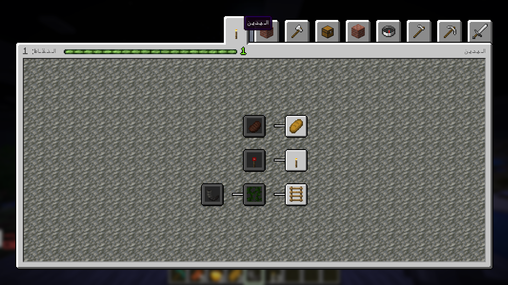
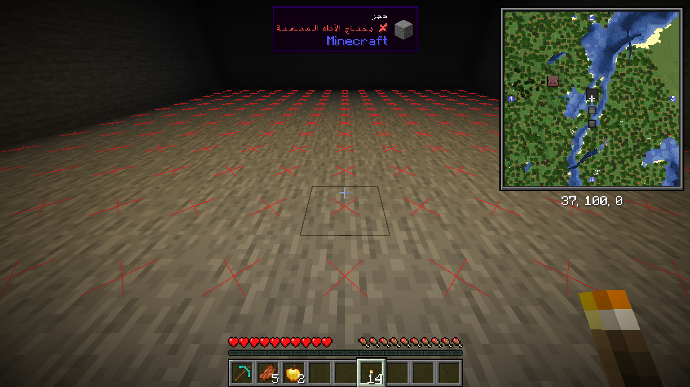
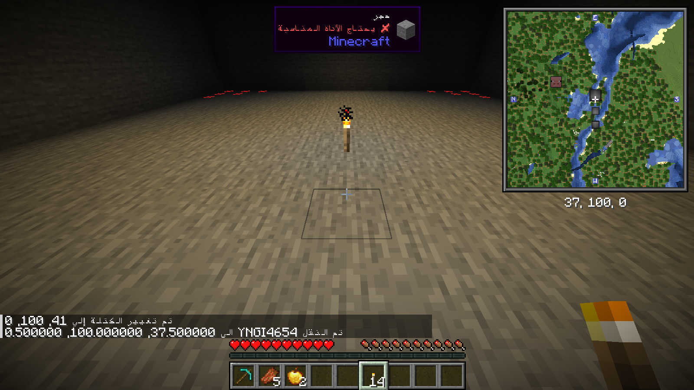

# Hands: design

Your hands keep up with you: hit a block and the right tool from your hotbar is in your hand,
place your last block and the next stack is there, break your pickaxe and the next one takes
its place. No keys, no screens, nothing to set up.

## 1. Outcome

No more scrolling the hotbar between stone and dirt, no more opening the inventory mid-build to
fetch the next stack, no more digging on with your bare hand after a tool breaks.

## 2. Prior art (searched 2026-11-25)

| What | Where | Kind | Use |
|---|---|---|---|
| Horizon mods (GitHub `horizon-mod.toml`, 38 repos) | GitHub | no tool swap, refill or tool restock | build ours |
| AutoSwitch | Java (Fabric) | the best tool on attack, switch back after, per-tool rules | design only |
| Inventory Profiles Next | Java | hotbar refill, tool restock before it breaks, sorting | design only |
| Mouse Tweaks | Java | inventory drag and wheel gestures | out of scope (Storage has its own) |

(Also found while searching: two Horizon vein miners, VeinSweep and veinminer-horizon, published
after Gathering's search; Gathering stays ours, with trees, harvest and the Skills tie.)

## 3. How it plays

- **The right tool**: hit a block and the hotbar's fastest tool for it comes to your hand
  (pickaxe on stone, axe on wood, shovel on dirt, shears on leaves). A tool that would break on
  this block (one use left) is passed over.
- **Back to what you held**: a second after you stop digging, the hand goes back to the slot you
  had (so you can go on placing the block you held).
- **Refill**: when a hotbar stack runs out by use (placing, eating, throwing a pearl), the same
  item from your inventory fills the slot. Dropping it (Q) or putting it away doesn't.
- **A new tool**: when your tool breaks, one of the same kind from your inventory takes its slot
  (a diamond pickaxe for a diamond pickaxe, else another pickaxe).
- **Sneak** while hitting: no swap.

## 4. Choices

| Question | Picked | Over | Why |
|---|---|---|---|
| Who swaps the tool | the server, on the block's first hit (`left_click_block` → `set_selected_slot`) | the client before the hit | the client can't read its hotbar through the API; the server costs 1 to 6 ticks once (measured) |
| How a run-out is seen | the hand compared tick to tick | the tool-break hook | the hook is not heard for the LAN host (you), the comparison is (measured) |
| Skills | free for everyone | a Skills tree | small comforts the game should have had; nothing to earn |

## 5. Measured (owner's PC, Horizon f037744, a spike build, 2026-11-25)

| Case | Result |
|---|---|
| Stone, diamond pickaxe already in hand | broken in 6 ticks |
| Stone, dirt in hand, pickaxe in the hotbar | swapped on the first hit (speed 1 → 8), broken in **12 ticks** (6 more, once) instead of 150 by hand |
| Oak log, dirt in hand, axe in the hotbar | swapped, **14 ticks** against 13 with the axe already in hand |
| Last cobblestone placed, 64 in the inventory | the slot held 64 again the next tick, the inventory slot empty |
| Diamond pickaxe broken on its last use (single player host) | a spare diamond pickaxe from the inventory was in the slot the next tick |
| Clearing the inventory with a command | the spike also "refilled" (nothing there): the build tells use from drop and clear |

## 6. The skeleton (0.1.0), measured in the game (2026-11-25)

The swap, the refill and the new tool, with the decisions on plain values (`rules.rs`, tested)
and the server hooks (`left_click_block`, `item_toss`, the tick's hand comparison).

| Case | Result |
|---|---|
| Dirt in hand, diamond pickaxe in the hotbar, stone | swapped, broken in 8 ticks |
| The same while sneaking | no swap: dirt stays in hand |
| Diamond pickaxe with one use left and a stone pickaxe in the hotbar | the stone pickaxe was picked (14 ticks), the worn one kept |
| Last cobblestone placed, 64 in the inventory | slot refilled with 64, the inventory slot emptied |
| Last cobblestone dropped with Q | no refill: the 64 stayed in the inventory |
| Iron pickaxe broken, a stone pickaxe in the inventory | the stone pickaxe took its slot (same kind) |

## 7. Back to what you held (0.2.0), measured in the game (2026-11-25)

A swap remembers the slot held before it; each tick the game asks the player's break speed while
a dig goes on (`player_break_speed` on the server), and 20 ticks without one bring the hand back.
A second swap keeps the first slot; a slot the player picks themself ends it.

| Case | Result |
|---|---|
| Dirt in hand, stone broken with the swapped-in pickaxe | dirt back in hand after the drops settled |
| Obsidian (194 ticks with a diamond pickaxe) | dug to the end with the pickaxe, then dirt back |
| Swapped, then the player picked slot 5 | slot 5 stayed |

## 8. Comforts earned in a Skills tree Hands (0.3.0), measured in the game (2026-11-26)

(0.4.0 moved the nodes into Skills' own trees and Spawn Marks into Map: see §9.)

Three comforts from batch 2 and two from batch 3, each off until earned and each with its own off switch (Options >
Mods > Hands > Config; `all_comforts` opens them without Skills). As with Gathering and Storage
there is no code tie: a node gives a vanilla tag (`hands.eat.14`, `hands.eat.17`, `hands.torch`,
`hands.marks`, `hands.climb.150`, `hands.climb.200`, `hands.whistle`), the tree is a data file Skills reads (`data/hands/skills/hands.json`).

| Row | Nodes |
|---|---|
| Survival | **Snack I** (eat below 14) → **Snack II** (eat below 17) |
| Caves | **Torch Hand** → **Spawn Marks** |
| Travel | **Quick Climb I** (1.5x) → **Quick Climb II** (2x) → **Horse Whistle** |

The tree earns from pickaxe and shovel use, torches placed (`minecraft:used`), climbing and riding
(`climb_one_cm`, `horse_one_cm`).

- **Eat on its own**: each server tick reads the food level (`food_level_changed` is never sent
  for the host of a LAN world, the owner); below the line, the food that fills the most of what is
  missing and wastes the least is eaten (`feed`, the stack shrinks first). Never eaten: rotten
  flesh, spider eye, poisonous potato, pufferfish, raw chicken, golden apples, suspicious stew,
  chorus fruit, and any food with an effect on eating or a bowl or bottle left behind.
- **Torch Hand**: `use_item_on_block` in its `ItemAfterBlock` phase, so a block's own use wins
  (a chest or door opens as always); a pickaxe or shovel on a floor or wall whose spot is dark
  (no block light, sky light after the time's darkening at most 7) places a torch or wall torch
  from the inventory (main inventory first, the smallest stack), checked with `may_use_item_at`
  and face support; creative pays nothing; never on a ceiling.
- **Spawn Marks**: the client, while a torch is in either hand, puts a small red cross on every
  opaque full block within 16 blocks (8 up and down) with two airs above and monster darkness.
  Found again only when the player moves a block, the sky's darkening changes, or a block or light
  packet arrives (2 and 12 ticks later, after the client's own light update); each frame only
  draws. The server tells each client whether it earned them (`hands:marks`).
- **Quick Climb**: each server tick, a player on a ladder or vine (`is_climbing`) looking up at
  least 20° and already going up gets an upward speed (`PlayerRef::set_velocity`; the client owns
  its motion and takes it from its next tick). The game climbs 0.115 blocks a tick and a speed sent
  this way moves 0.89 of itself, so "1x" is 0.129 (measured, `rules::GAME_CLIMB`).
- **Horse Whistle**: while a player rides a horse, donkey, mule, skeleton or zombie horse or
  camel, it gets the tag `hands.rider.<uuid>` (kept over restarts; removed from the horses ridden
  before). A goat horn blown while sneaking (`right_click_item`, the horn still sounds) brings the
  nearest tagged, tamed horse with nobody on it within 128 blocks in the same world
  (`teleport_to`).

| Case (dark stone rooms at y 100, survival) | Result |
|---|---|
| Snack I, hunger draining, 3 steaks, 5 bread, rotten flesh, golden apples | steak at 13 (to 20) three times, then bread at 13 (to 18) five times; rotten flesh and golden apples never eaten, even starving |
| Snack II | ate as the bar fell past 17 |
| Torch Hand, diamond pickaxe on a dark wall | wall torch facing out, 16 torches → 15 |
| Same on a dark floor / a ceiling / a lit wall | torch / nothing / nothing |
| Right-click a chest with the pickaxe | the chest opened, no torch |
| Torch switched off in the settings, dark wall | nothing; on again: torch |
| No tags | no torch, no eating, no marks |
| Spawn Marks, torch held in a 15×15 dark room | a red cross on every floor block |
| A torch set in the room | the crosses around it gone at once; far corners keep theirs |
| Pickaxe in hand, or marks switched off | no crosses |
| Quick Climb, 2 s up a ladder looking up: none / I / II / II looking ahead | 4.59 / 7.01 (1.53x) / 9.50 (2.07x) / 4.59 blocks |
| Horse Whistle: tamed saddled horse ridden, then 53 blocks away, horn while sneaking | the horse stood at the player's spot |
| The same horn not sneaking | the horse stayed |
| 120 blocks away / 142 blocks away | came / stayed |
| A villager riding the horse, 68 blocks away | stayed; once it got off, came |
| Skills screen | the Hands tab with its rows; the bar filled from the test's digging and torches |

## 9. Into Skills' own trees (0.4.0, 2026-11-26)

Owner's rule: new work extends what exists and never repeats a meaning. A tree of Hands' own
repeated Skills' trees, and the in-world spawn marks repeated Map's light overlay, so:

- The tree `hands:hands` is gone. Hands ships three files that extend Skills' trees, with the
  same tag perks (progress in the old Hands tab starts again from zero):

  | Skills tree | Nodes (row) | Extra experience |
  |---|---|---|
  | Mining (`skills:mining`) | **Torch Hand** (row 7, below Gathering's rows 5 and 6) | torches placed (`minecraft:used` torch); pickaxe and shovel blocks Mining already counts |
  | Exploration (`skills:exploration`) | **Quick Climb I → II → Horse Whistle** (row 5) | none: climbing and riding already count |
  | Farming (`skills:farming`) | **Snack I → II** (row 7, below Gathering's rows 4 to 6) | none |

- **Spawn Marks** left Hands: Map 0.3.0 draws its light overlay in the world too, with the same
  rule as the map (one `light::Rule`: block or sky light between the overlay's min and max, red at
  0, yellow above), earned with Map's own node **Spawn Sight** (`map/data/map/skills/mining.json`, extends Mining,
  tag `map.marks`), read on the client through Skills 0.2.1's `skills::has_tag`. The marks code (`client.rs`, the `hands:marks` payload)
  is removed from Hands.

| Check (0.4.0, in the game) | Result |
|---|---|
| Skills screen | no Hands tab, no node on another's spot (`tools/overlap_gate.py`); Torch Hand in Mining, Quick Climb and Horse Whistle in Exploration, Snack in Farming |
| The comforts with their tags | unchanged from §8 (same code and tags) |

## 10. Risks and answers

| Risk | Answer |
|---|---|
| Swapping while you meant to hit with a sword | only blocks swap; hitting mobs never does |
| The swap restarts the dig | measured 1 to 6 ticks once per block, then normal |
| Refill on a drop | drops (`item_toss`) and inventory moves are told apart from use |
| A favourite tool used up | a tool with one use left is never picked, and a broken one is replaced only by its own kind |
| Silk Touch or Fortune wanted on purpose | the hand only changes when the held item is slower; a tool you chose that mines the block stays |
| Eating something you meant to keep | golden apples and every food with an effect are never eaten; the switch turns it off |
| A torch where you wanted a path (shovel on grass) | only on dark spots, where monsters would spawn anyway |

## 11. Phases

1. The right tool, back to what you held, refill, a new tool: all built in 0.2.0.
2. Skills tree Hands with eat on its own, Torch Hand, Spawn Marks, Quick Climb and Horse Whistle:
   built in 0.3.0.
3. Nodes moved into Skills' Mining, Exploration and Farming trees; Spawn Marks moved into Map: 0.4.0.
